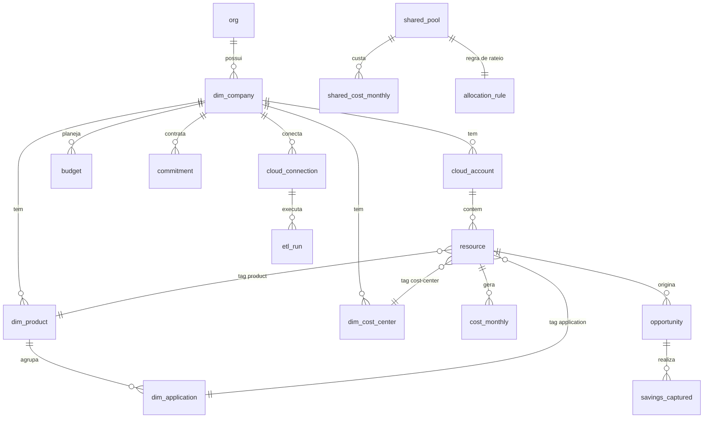

# Modelo de dados

DDL completo em `database/schema.sql` e views em `database/views.sql`.

| Tabela | Papel |
|---|---|
| `org`, `dim_company`, `dim_cloud` | tenant, empresas do Grupo e provedores |
| `cloud_account` | conta/assinatura/tenancy/projeto/domínio por empresa |
| `dim_product`, `dim_application`, `dim_cost_center` | hierarquia de negócio (`chargeback_enabled` por produto) |
| `resource` | inventário unificado + tags + flags (`is_idle`, `is_orphan`, `is_optimized`, `naming_ok`) |
| `cost_monthly` | fato: custo BRL por recurso/mês |
| `shared_pool`, `shared_cost_monthly`, `allocation_rule` | custos compartilhados e rateio |
| `budget` | orçamento mensal por empresa (realizado + 3 meses futuros) |
| `commitment` | Savings Plans, RIs, Reservations, CUDs com cobertura e utilização |
| `opportunity`, `savings_captured` | oportunidades (esforço, prazo, risco, score) e economia realizada |
| `tag_policy` | política de tags obrigatórias |
| `cloud_connection`, `etl_run` | conectores (segredo criptografado) e execuções de ETL |

**Hierarquia de showback:** Empresa → Produto → Aplicação → Serviço → Recurso (via `resource.product_id/application_id`, preenchidos a partir das tags).
